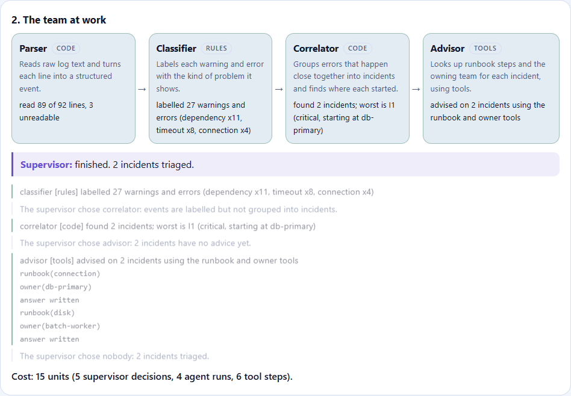
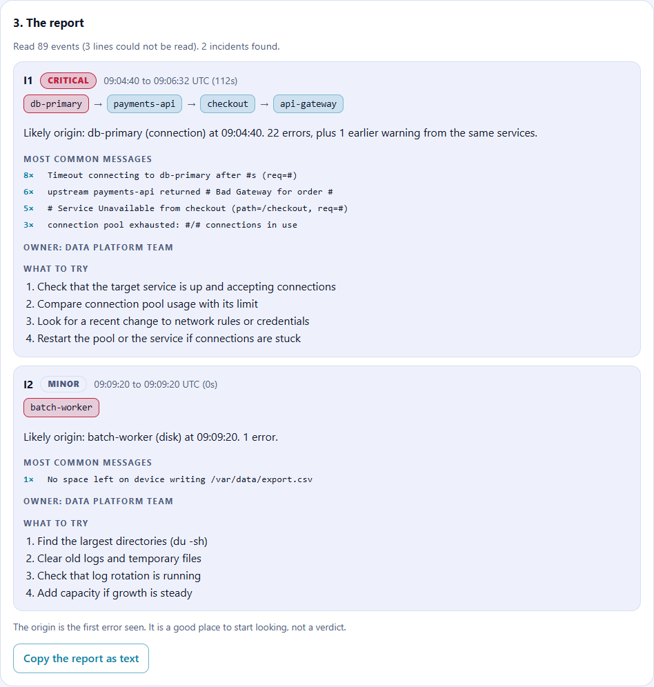
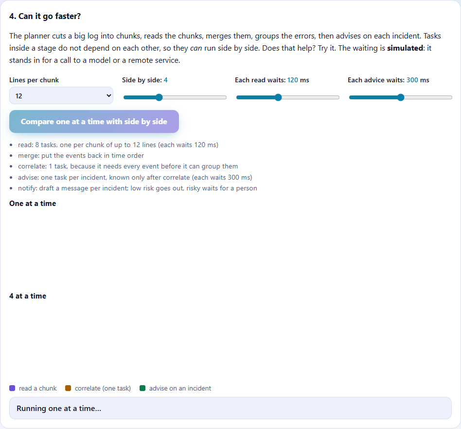
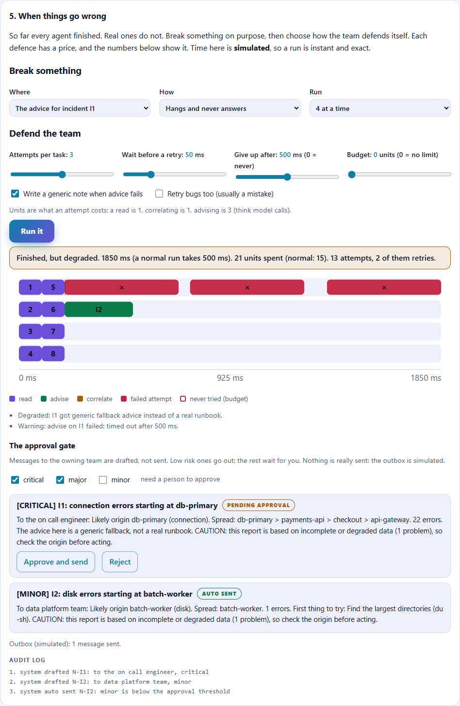
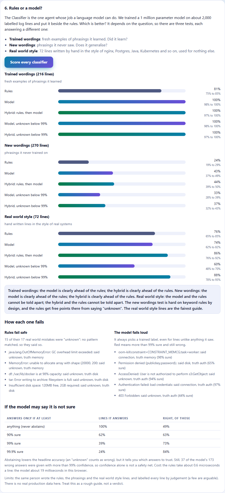

# TinyAIOrchestrator

Learn how AI agents are orchestrated by watching a team of four triage an incident. Plain TypeScript, no dependencies,
short enough to read in an afternoon. It runs in your browser, and nothing you connect leaves it.

This is the second project in a series. [TinyAgentBuilder](https://github.com/masterthefly/tinyagentbuilder) builds one agent.
This one asks what changes when you have several.

**Status: early.** Three pieces work: a supervisor, four agents, three ways to connect your own logs and a full trace; a
planner that cuts a big log into tasks, with a timeline chart that shows when running them side by side helps and when it does not;
the controls for when things go wrong (fault injection, retries, timeouts, a budget, fallbacks and a human approval gate); and a small trained model
that can do the Classifier's job, measured honestly against the rules; and a straight comparison of the whole team against one plain function, to see what the orchestration actually buys.

## What it looks like

| The team at work | The report |
|---|---|
|  |  |

| Running tasks side by side | When things go wrong |
|---|---|
|  |  |

Scoring rules, a small model and a hybrid, with a range around each score:



## The team

You give it a log. It tells you what went wrong, where it probably started, and who to call.

| Agent | Job | How it works |
|---|---|---|
| Parser | Turns raw lines into events (three common log formats) | Code |
| Classifier | Names the kind of problem: timeout, disk full, auth and so on | Rules, a small language model we trained, or both (you choose) |
| Correlator | Groups errors into incidents and finds the first one | Code |
| Advisor | Looks up runbook steps and the owning team | A tool using agent, built on the agent loop from the first project |

A **supervisor** looks at the case file, decides which agent works next, and says why. Every decision, every agent run and
every tool call lands in a trace, and the cost is counted. That is most of what orchestration is.

## Connect your own logs

- **Paste** text into the page, or **upload** a file. It is read in your browser.
- **Fetch from a URL.** This only works when the other site allows web pages to read it (CORS), so the page explains what to do when it refuses.
- **Write a connector.** A connector is a name, a description, named arguments and a function that returns text, the same
  shape as a tool in an agent or one served over MCP. See `src/connectors.ts`.

## Run it

You need [Node.js](https://nodejs.org/) 22.18 or newer. There is nothing to install.

```bash
npm test                        # tests
npm run serve                   # the page, at http://localhost:8080
npm run triage -- sample        # the same team in the terminal, on the built in example
npm run triage -- file app.log  # or on your own file
npm run plan -- sample          # does running tasks side by side make it faster? measured
npm run chaos                   # a tour of failures, and what each defence costs
npm run eval:classifier         # rules, model and hybrid on three test sets, with error bars
npm run compare                 # one plain function against the whole team: answer, failures, cost, size
```

## Layout

```
src/
  orchestrator.ts      the generic loop: supervisor, agents, trace, cost
  incident/            the four agents, the supervisor, the runbooks
  compare/             the same job as one plain function, and the head to head measurements
  plan/                the planner, the executor, the clock (real and virtual), the failure controls and the approval gate
  model/               the log classifier: prompt format, model wrapper, hybrid
  data/                training templates, the hand written real world test lines, the data generator
  eval/                scoring a classifier, with the range around each score
  connectors.ts        how data gets in
  sample-log.ts        the built in example incident
  report.ts            the trace and the report as text
  kit/                 the agent loop, copied from TinyAgentBuilder (see NOTICE.md)
test/                  tests
web/                   the page
```

`web/js`, `web/src` and `web/data` are build output and are not committed. The small model in `web/model/` was fine tuned with
[TinyLanguageBuilder](https://github.com/masterthefly/tinylanguagebuilder) on `data/log-train.jsonl`; `npm run data:log` regenerates the data.

## License

MIT. See [LICENSE](LICENSE).
